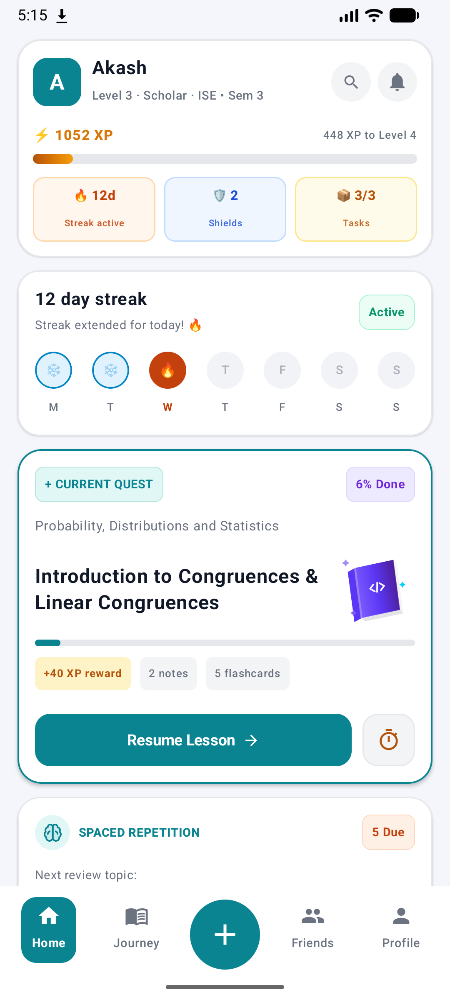
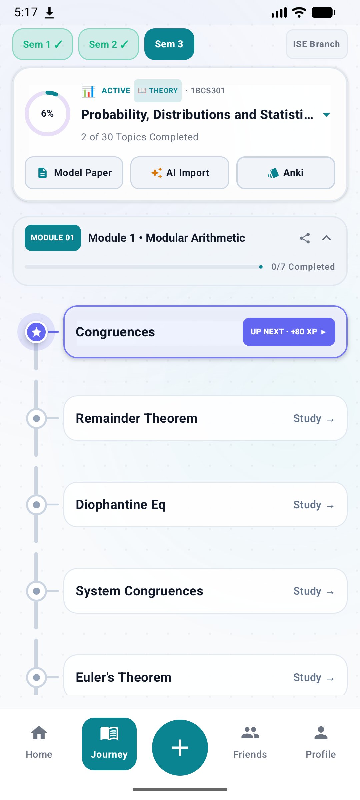
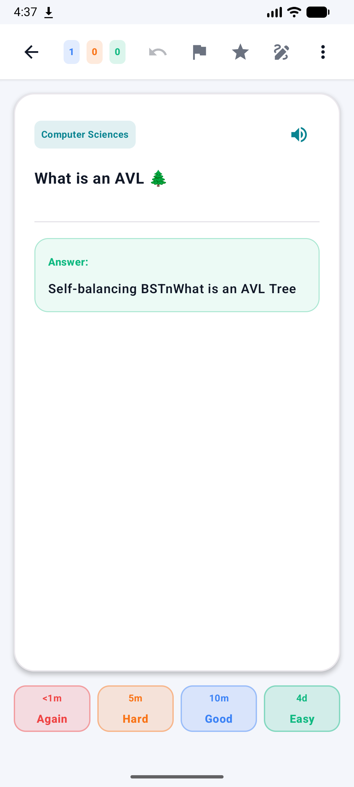
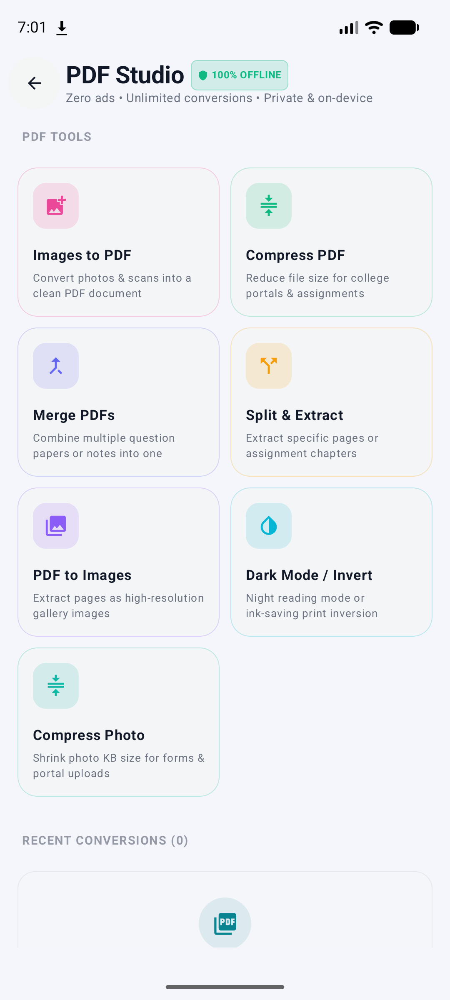
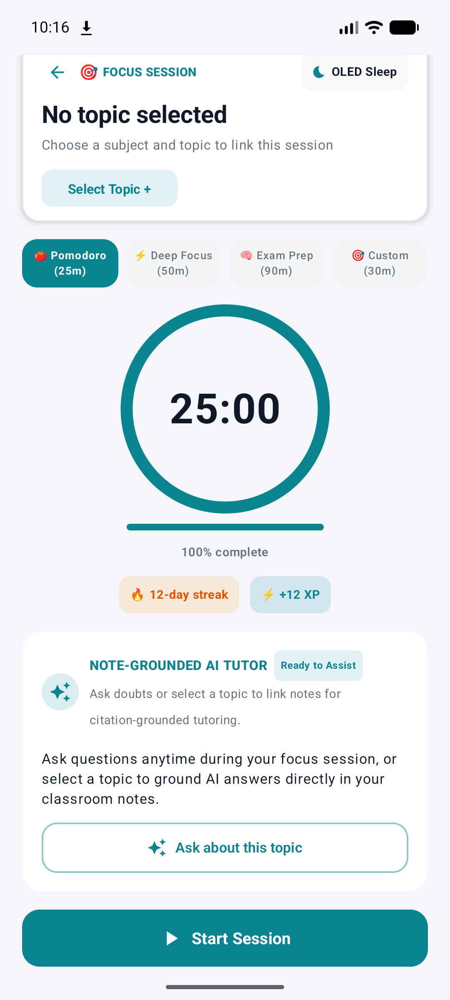
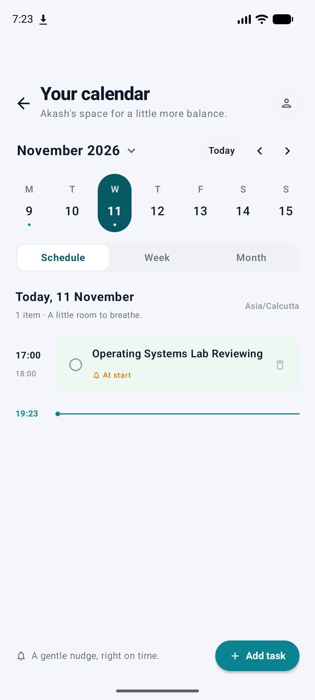
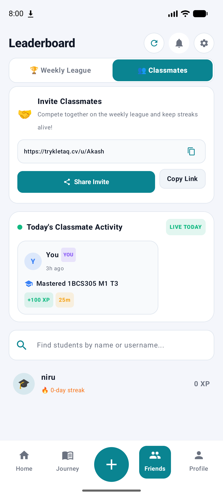
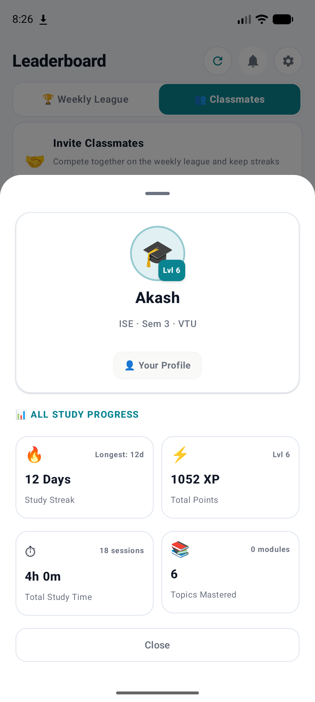

<div align="center">

# 🎓 Kletaq

### *Gamified Curriculum Mastery, AnkiDroid-Parity Flashcards, Offline PDF Studio & Focus Engine*

Gamified academic learning, visual syllabus journeys, 100% AnkiDroid-parity spaced repetition (FSRS & SM-2), 100% offline PDF & photo studio, uncapped BYOK multi-provider AI tutor, deep focus timer, automated streak engine, authentic model papers, and reactive companion widgets built for engineering undergraduates, pre-university, and school students.

[](https://github.com/Akashkatageri/kletaq/releases/tag/Latest)
[](https://kotlinlang.org)
[](https://developer.android.com/jetpack/compose)
[](https://m3.material.io)
[](https://developer.android.com)
[](https://firebase.google.com)
[](https://developer.android.com/jetpack/compose/glance)
[](https://developer.android.com/topic/libraries/architecture/workmanager)
[](https://trykletaq.cv)

</div>

---

## 📱 Interface Showcase (v1.29.002 — Oceanic Teal Theme)

<div align="center">
<table>
  <tr>
    <td align="center"><b>Home Dashboard</b><br></td>
    <td align="center"><b>Metro Roadmap</b><br></td>
    <td align="center"><b>Anki Flashcards Study</b><br></td>
    <td align="center"><b>Offline PDF Studio</b><br></td>
  </tr>
  <tr>
    <td align="center"><b>Focus Timer</b><br></td>
    <td align="center"><b>Study Calendar</b><br></td>
    <td align="center"><b>Classmates & Live Feed</b><br></td>
    <td align="center"><b>Student Profile Sheet</b><br></td>
  </tr>
</table>
</div>

---

## 📖 Overview

**Kletaq** transforms rigid, stressful academic curriculums into an engaging, gamified learning journey. Styled in **Oceanic Teal (`#0A8491`)** with crisp paper surfaces and full dark/light adaptation, Kletaq is built for **Engineering Undergraduates** (VTU 2021/2022/2025 Schemes & autonomous universities), **Pre-University Students** (PUC 1st/2nd Year Science/Commerce/Arts), and **School Students** (Classes 1–10 CBSE, ICSE, and State Boards):

- 🗂️ **100% AnkiDroid-Parity Flashcards (FSRS & SM-2)**: Full FSRS + SuperMemo SM-2 spaced repetition, `.apkg` / `.colpkg` import & export (with Zstandard Anki 2.1.50+ decompression), CSV/TSV import, in-card whiteboard scratchpad, cloze deletions, type-in answers, math/LaTeX rendering, multi-image attachments with pinch-to-zoom, audio chips, and subdecks.
- 📄 **100% Offline PDF & Photo Studio**: Zero-ad on-device suite with Images to PDF, Compress PDF, Merge PDF, Split / Extract Pages, PDF to Images, Dark Mode / Invert PDF, and Exact-KB Photo Compressor (`<50 KB`, `<100 KB`) for college portals.
- 🤖 **Uncapped BYOK Multi-Provider AI & Multimodal OCR**: Encrypted on-device Bring-Your-Own-Key router supporting Google Gemini (`gemini-3.5-flash`), Groq (`llama-3.3-70b-versatile`), OpenRouter, DeepSeek, OpenAI, and custom OpenAI-compatible endpoints, paired with offline-first PDF stream extraction, ML Kit OCR, and 2048px print rasterization.
- 🚇 **Metro Roadmap & Universal Syllabus Builder**: Interactive subway-track visual roadmap with technical dot-grid canvas, custom node builders, dynamic note/flashcard chips, and AI syllabus extraction.
- 📝 **Authentic Model Question Papers & PDF Lab Extraction**: Full 100-mark VTU pattern question papers with 5-module choice and in-app pan & zoom viewer, plus lab blueprints & drills parsed directly from uploaded PDF lab manuals.
- ☁️ **High-Performance Cloud Notes Sync**: Adaptive compressed lecture notes with instant cloud synchronization, offline caching, and secure token-based user authentication.
- 🛡️ **Enterprise Security & Anti-Tamper Guard**: Runtime signature verification, root/Frida hooking detection, Firebase App Check (Play Integrity), and hardened Firestore security rules.
- 🏆 **Duolingo-Style Competitive Leagues & Classmates**: 10 weekly tiers (Bronze to Diamond), live classmate activity feed (`LIVE TODAY`), student profile sheets, and 1-tap invite links (`trykletaq.cv/u/<username>`).
- 🐼 **Reactive Home Screen Companion Widgets (Glance)**: 2×1 dynamic Panda companion with 5 expressive mood states, lit vs. greyed/frozen flame tracking, and victory sunbursts.
- 🌙 **4:00 AM Study Day Rollover & Resilient Streaks**: Natural study day boundary for late-night learners, proactive 7:00 PM reminders, and automated streak shields.
- ⏱️ **Deep Focus Timer with Parkinson's Law**: 2× Bonus XP urgency engine, OLED battery-saver ambient mode, and topic-linked Pomodoro intervals.

---

## ✨ Key Features

### 🗂️ 100% AnkiDroid-Parity Flashcards (`features/flashcards`)
- **Dual FSRS & SuperMemo SM-2 Schedulers**: Choose modern **FSRS** (`FsrsScheduler.kt`) or classic **SM-2** (`AnkiScheduler.kt`) with dynamic interval previews (`Again`, `Hard`, `Good`, `Easy`) and memory decay tracking.
- **Full `.apkg` / `.colpkg` Import & Export**: Import existing Anki decks—including modern Anki 2.1.50+ packages compressed with **Zstandard (`zstd-jni 1.5.6-8`)**—directly via system **"Open with Kletaq"** file/MIME filters, CSV/TSV delimited text files (`DelimitedTextImporter.kt`), or 1-tap deck sharing (`FlashcardShareManager.kt`).
- **Rich Card Types & Active Tools**:
  - **Cloze Deletions (`{{c1::...}}`)** & **Type-in Answer Diff Checking** ([`ClozeParser.kt`](app/src/main/java/com/kletaq/app/features/flashcards/engine/ClozeParser.kt), [`AnswerDiffCalculator.kt`](app/src/main/java/com/kletaq/app/features/flashcards/engine/AnswerDiffCalculator.kt)).
  - **In-Card Whiteboard Scratchpad** ([`FlashcardWhiteboard.kt`](app/src/main/java/com/kletaq/app/features/flashcards/ui/components/FlashcardWhiteboard.kt)) for working out derivations and formulas right on top of the card.
  - **Multi-Image Attachments, Audio Chips & Math/LaTeX**: Pinch-to-zoom image viewer ([`FlashcardZoomViewer.kt`](app/src/main/java/com/kletaq/app/features/flashcards/ui/components/FlashcardZoomViewer.kt)), inline voice clips, and mathematical formula rendering ([`FlashcardMathView.kt`](app/src/main/java/com/kletaq/app/features/flashcards/ui/components/FlashcardMathView.kt)).
- **Consolidated Hub, Card Browser & Review Heatmaps**: Multi-subject deck hierarchy (`New` / `Learning` / `Due`), full-text search with status filter chips (`FlashcardBrowserScreen.kt`), custom study sessions, and Journey topic synchronization.

### 📄 100% Offline PDF & Photo Studio (`features/pdfstudio`)
- **7 Private On-Device Utilities ([`PdfStudioEngine.kt`](app/src/main/java/com/kletaq/app/features/pdfstudio/engine/PdfStudioEngine.kt))**:
  - **Images to PDF**: Combine gallery captures and scans into clean printable PDFs.
  - **Compress PDF**: Reduce document file sizes locally for fast portal uploads.
  - **Merge & Split / Extract PDF**: Combine lecture modules or extract exact page ranges cleanly.
  - **PDF to Images & Dark Mode / Invert PDF**: Export document pages as crisp images or invert bright scans for night reading.
  - **Exact-KB Photo Compressor (`CompressPhotoScreen.kt`)**: Hit strict student portal upload limits (`<50 KB`, `<100 KB`, custom targets) with real-time dimension and quality tuning.
- **Zero Ads & Local History**: Runs 100% offline with zero server uploads and instant access to recent studio outputs (`PdfStudioHistoryRepository.kt`).

### 🤖 Uncapped BYOK Multi-Provider AI & Multimodal OCR (`core/ai`, `core/notes`)
- **Encrypted Multi-Provider Bring-Your-Own-Key (BYOK)**: Configure personal keys in [`SecureAiPreferences.kt`](app/src/main/java/com/kletaq/app/core/ai/SecureAiPreferences.kt) and route seamlessly through [`UnifiedAiClient.kt`](app/src/main/java/com/kletaq/app/core/ai/UnifiedAiClient.kt) across:
  - **Google Gemini** (`gemini-3.5-flash` with fallback cascade)
  - **Groq Cloud** (`llama-3.3-70b-versatile`)
  - **OpenRouter** (`openrouter/free` multi-model routing)
  - **DeepSeek Official** (`deepseek-chat`)
  - **OpenAI** (`gpt-4o-mini`) & **Custom OpenAI-Compatible Endpoints**
- **High-Fidelity Multimodal Document Ingestion**: Combines offline-first PDF stream extraction, on-device **ML Kit Text Recognition (`19.0.1`)**, and **2048px** print-resolution rasterization with LaTeX extraction for note-grounded tutoring inside both syllabus topics and custom uploaded PDFs.

### 🚇 Metro Roadmap, Home UI & Universal Curriculum Journey
- **Oceanic Teal Visual System (`v1.29.001`–`v1.29.002`)**: Modern Oceanic Teal (`#0A8491`) palette, crisp card borders, frosted freeze streak indicators, Today's Tasks with due dates on Home, and dynamic Current Quest note/flashcard count chips.
- **Metro Transit Track Rail**: Modules and topics render as a continuous metro line with circular station nodes, glowing active pulses, and checkmark mastery rings against a subtle technical dot-grid background.
- **Interactive Visual Roadmap Builder & Lab PDF Extraction**: Add custom subjects, modules, and topic nodes with custom durations and emojis, parse syllabi via PDF/text, and generate practical lab blueprints & drills from uploaded college lab manual PDFs (`features/lab`).

### 📄 Authentic Model Question Papers & Custom Attachments
- **100-Mark Authentic Exam Pattern**: Modeled strictly after official VTU examination standards with 5 Modules, choice-based sub-questions (Parts A & B), and marks allocations.
- **AI Evaluator Rubrics & Offline Attachments**: Integrated marking rubrics plus personal university model paper ingestion with offline disk caching.
- **In-App Pan & Zoom Viewer**: Custom fullscreen viewer ([`CustomModelPaperFullscreenDialog.kt`](app/src/main/java/com/kletaq/app/features/journey/components/CustomModelPaperFullscreenDialog.kt)) with multi-touch pinch-to-zoom and fluid drag panning.

### ☁️ High-Performance Cloud Notes & Adaptive Compression
- **Secure Cloud Storage Bridge**: Authenticated serverless backend executing strict token identity verification and user-path ownership checks before granting upload or download access.
- **Adaptive Client-Side Compression**: Multi-pass image and PDF downsampling ([`NoteCompressionEngine.kt`](app/src/main/java/com/kletaq/app/core/notes/NoteCompressionEngine.kt)) targeting 1080p and 60% quality, preventing bandwidth bloat and keeping uploads fast.
- **Dual-Layer Notes Persistence**: Resilient local offline disk cache backed by seamless cloud sync and Firestore document tracking.

### 🏫 Universal Multi-Tier Onboarding (School, PUC & College)
- **School Students (Classes 1–10)**: Support for CBSE, ICSE, and State Boards with tailored foundational curriculums.
- **Pre-University (PUC 1st & 2nd Year)**: Dedicated streams for Science (PCMB/PCMC), Commerce, and Arts.
- **Engineering Undergraduates**: Schemes for VTU (2021, 2022, 2025 Schemes) and autonomous engineering institutions.
- **Adaptive Terminology**: Dynamically shifts app-wide UI labels between **Board · Class · Academic Year** and **University · Scheme · Branch · Semester**.

### 🛡️ Enterprise Runtime Security & Anti-Tamper Hardening
- **`SecurityGuard.kt` Runtime Checks**:
  - **APK Signature Verification**: Validates signing certificate SHA-256 fingerprint against trusted whitelist to block repackaging and smali modding.
  - **Root Detection**: Scans for standard root binaries (`su`, `busybox`, `magisk`) and test-keys build tags.
  - **Frida Hooking Detection**: Inspects native `/proc/self/maps` and local memory for dynamic hooking frameworks (Frida, Xposed, Substrate).
  - **Debugger Detection**: Identifies connected debuggers (`Debug.isDebuggerConnected()`).
- **Firebase App Check & Play Integrity**: Secures backend Firestore and Auth requests against bot abuse and unauthorized clients, with debug provider support for development builds.
- **Hardened Firestore Security Rules & Prompt Sandboxing**: Granular user-ownership constraints (`request.auth.uid == userId`), client-side prompt isolation, strict TLS enforcement, and encrypted on-device BYOK API key storage.

### 🏆 Competitive Weekly Leagues & Classmates (`features/friends`)
- **10 Duolingo-Style League Tiers**: Advance from **Bronze** through Silver, Gold, Sapphire, Ruby, Emerald, Amethyst, Pearl, Obsidian, to **Diamond League** with automated Sunday midnight evaluations.
- **"LIVE TODAY" Classmate Activity & Profile Sheets**: Real-time classmate study feed and detailed `StudentProfileBottomSheet` showing streaks, total XP, focus hours, and mastered syllabus topics.
- **1-Tap Social Invites**: Shareable personal invite links (`https://trykletaq.cv/u/<username>`) with one-click clipboard copying.

### 🐼 Reactive Companion Home Screen Widgets (Glance)
- **2×1 Panda Mini Widget & Dashboard Widget**: Displays active study flame (`🔥 streakCount`), daily progress, and motivational state cards.
- **5 Approved Visual States**: `panda_ready`, `panda_welcome`, `panda_complete`, `panda_revision`, and `panda_sleepy`, paired with dynamic lit flame vs. frozen/grey flame tracking and victory emerald sunbursts.
- **Atomic Glance Sync**: Single-pass SharedPreferences and Glance DataStore synchronization prevents SystemUI throttling.

### 🌙 4:00 AM Study Day Rollover & Resilient Streak Protection
- **4:00 AM Natural Study Day Boundary**: Sessions logged between 12:00 AM and 3:59 AM count towards the previous day's study goal.
- **Autonomous Midnight Worker & Auto-Refilling Shields**: Daily `WorkManager` evaluation with up to 3 shields (auto-refills back to 3 at 1 or below, 2 free weekly shields, zero-streak immunity) and 7:00 PM proactive reminders.

### ⏱️ Deep Focus Timer with OLED Ambient Mode
- **⚡ Parkinson's Law 2× Bonus XP**: Complete focus quests within estimated time limits to earn **40 XP (2× boost)**.
- **🌙 OLED Black Ambient Saver**: Ultra-minimalist pitch-black screen for AMOLED displays with anti-burn-in drift and screen wake lock.
- **Note-Grounded Focus Integration**: Topic-linked Pomodoro intervals (25m / 50m / 90m / custom) with inline Note AI Tutor and topic notes previews.

### 🔄 In-App OTA Updates & Automated CI/CD
- **In-App Updater ("Check for Updates")**: Built-in APK updater under Settings checks GitHub Releases (`tag/Latest`) and fails over across `trykletaq.cv`, `kletaq.5122006.xyz`, and GitHub Releases API.
- **Web Distribution & Portal**: Live website at [trykletaq.cv](https://trykletaq.cv) kept in sync via `update-website-apk.ps1`.
- **GitHub Actions Release Pipeline**: Automatically builds and publishes the `benchmark` APK on every push to `master`.

---

## 🧪 Scientific Study Techniques & Cognitive Architecture

Kletaq is engineered around validated cognitive psychology, educational neuroscience, and behavioral economics methodologies:

### 1. ⚡ Parkinson's Law & Urgency Engineering (2× Bonus XP)
* **Scientific Basis:** Formulated by Cyril Northcote Parkinson (1955): *"Work expands so as to fill the time available for its completion."* Intentionally compressing target duration by **15–20%** creates healthy urgency, sharpens focus, and eliminates procrastination.
* **Implementation in Kletaq:** Integrated into [`QuestFocusTimerScreen.kt`](app/src/main/java/com/kletaq/app/features/quest/QuestFocusTimerScreen.kt), [`ProgressionRepositoryImpl.kt`](app/src/main/java/com/kletaq/app/data/repository/ProgressionRepositoryImpl.kt), and [`QuestCompletionDialog.kt`](app/src/main/java/com/kletaq/app/features/quest/components/QuestCompletionDialog.kt).

### 2. 🧠 Spaced Repetition (FSRS, SuperMemo SM-2 & Ebbinghaus Forgetting Curve)
* **Scientific Basis:** Hermann Ebbinghaus's forgetting curve demonstrates exponential memory decay over time ($R = e^{-0.70 \cdot \frac{t}{S}}$). Reviewing items right before memory decay converts short-term recall into durable long-term retention.
* **Implementation in Kletaq:**
  * [`FsrsScheduler.kt`](app/src/main/java/com/kletaq/app/features/flashcards/engine/FsrsScheduler.kt), [`AnkiScheduler.kt`](app/src/main/java/com/kletaq/app/features/flashcards/engine/AnkiScheduler.kt), [`SpacedRepetitionEngine.kt`](app/src/main/java/com/kletaq/app/core/utils/SpacedRepetitionEngine.kt), and [`TopicFlashcardDeckCard.kt`](app/src/main/java/com/kletaq/app/features/flashcards/TopicFlashcardDeckCard.kt).
  * Supports both FSRS memory stability/difficulty optimization and SM-2 easiness factors (`Again`, `Hard`, `Good`, `Easy`) alongside 5 memory health decay states (`FRESH`, `STABLE`, `FADING`, `WEAK`, `CRITICAL`).

### 3. 📝 Active Recall & Note-Grounded Testing (The Testing Effect)
* **Scientific Basis:** Roediger & Karpicke’s research confirms that actively retrieving knowledge from memory produces substantially higher retention and exam transfer compared to passive reading or highlighting.
* **Implementation in Kletaq:** Cloze deletions, type-answer diffs, whiteboard scratchpad recall, and topic checkpoint verifications grounded directly in attached classroom notes.

### 4. ⏱️ The Pomodoro Technique & Time-Boxing (Cognitive Fatigue Reduction)
* **Scientific Basis:** Francesco Cirillo's time-boxing combats cognitive fatigue by constraining focused work to distraction-free blocks (15–50+ minutes) followed by dedicated rest.
* **Implementation in Kletaq:** [`TimerScreen.kt`](app/src/main/java/com/kletaq/app/features/focus/TimerScreen.kt) & [`QuestFocusTimerScreen.kt`](app/src/main/java/com/kletaq/app/features/quest/QuestFocusTimerScreen.kt).

### 5. 🧩 Microlearning & Cognitive Load Theory (Miller's Law / Chunking)
* **Scientific Basis:** George Miller’s $7 \pm 2$ rule and John Sweller's Cognitive Load Theory demonstrate that working memory is easily overwhelmed by dense engineering textbooks.
* **Implementation in Kletaq:** [`MetroRoadmapNode.kt`](app/src/main/java/com/kletaq/app/features/journey/components/MetroRoadmapNode.kt) & [`JourneyScreen.kt`](app/src/main/java/com/kletaq/app/features/journey/JourneyScreen.kt).

### 6. 🔀 Interleaved Practice vs. Blocked Practice
* **Scientific Basis:** Mixing different subject matters and interleaving older review items with new concepts leads to significantly better problem-solving flexibility than repetitive cramming (Kornell & Bjork).
* **Implementation in Kletaq:** [`DailyTasksSection.kt`](app/src/main/java/com/kletaq/app/features/home/components/DailyTasksSection.kt).

### 7. 🔥 Habit Loops & Loss Aversion (Behavioral Economics)
* **Scientific Basis:** Charles Duhigg’s Habit Loop (*Cue $\rightarrow$ Routine $\rightarrow$ Reward*) paired with Kahneman & Tversky’s Prospect Theory (*Loss Aversion*).
* **Implementation in Kletaq:** [`StreakManager.kt`](app/src/main/java/com/kletaq/app/domain/streak/StreakManager.kt), [`MidnightStreakWorker.kt`](app/src/main/java/com/kletaq/app/notifications/MidnightStreakWorker.kt), and [`PandaMiniWidget.kt`](app/src/main/java/com/kletaq/app/widgets/ui/PandaMiniWidget.kt).

### 8. 💡 The Socratic Method & Feynman Technique (AI Topic Tutor)
* **Scientific Basis:** Richard Feynman’s principle of explaining complex ideas simply, paired with Socrates' guided questioning.
* **Implementation in Kletaq:** [`TopicChatViewModel.kt`](app/src/main/java/com/kletaq/app/features/chat/TopicChatViewModel.kt) powered by `UnifiedAiClient`.

---

## 🏛️ System Architecture

Kletaq follows **Clean Architecture** with a decoupled, modular, feature-first package structure:

```
com.kletaq.app/
├── core/                   # Shared framework, AI router, security & design system
│   ├── academic/           # Academic hierarchy & scheme helpers
│   ├── ai/                 # Unified BYOK multi-provider AI client & encrypted prefs
│   ├── config/             # Adaptive engine & learning parameters
│   ├── constants/          # App constants & configuration
│   ├── di/                 # Dependency injection (Hilt)
│   ├── flashcards/         # Topic-level flashcard repository bridge
│   ├── navigation/         # Central Compose navigation graph & routes
│   ├── notes/              # Cloud storage uploader, compression, OCR & note cache
│   ├── security/           # SecurityGuard anti-tamper, signature & root checks
│   ├── sound/              # Audio playback & study sounds
│   ├── syllabus/           # PDF/text syllabus extractor & parser
│   ├── theme/              # Oceanic Teal color tokens, typography, dark/light theme
│   ├── timetable/          # Timetable parser, compression & local store
│   ├── ui/                 # Shared Compose components & quick actions sheet
│   ├── update/             # In-app OTA updater & GitHub release client
│   └── util/ / utils/      # Notifications, SM-2 engine, alarms & receivers
│
├── data/                   # Data layer (remote, local, repositories)
│   ├── content/            # JSON syllabus loaders, study packs & offline assets
│   ├── local/              # DataStore & local persistence
│   ├── model/              # Firestore entities & data transfer objects
│   └── repository/         # Repository implementations (Auth, Friends, Tasks, Stats)
│
├── domain/                 # Pure domain business logic layer
│   ├── achievement/        # Badge & achievement computation
│   ├── journey/            # Adaptive curriculum progression engine
│   ├── model/              # Domain models & entities
│   └── streak/             # Streak calculation, shields & 4 AM validation rules
│
├── features/               # Feature presentation layer (Jetpack Compose & ViewModels)
│   ├── auth/               # Google Sign-In & authentication
│   ├── calendar/           # Study calendar & schedule alarms
│   ├── chat/               # Note-grounded Socratic AI Tutor & markdown rendering
│   ├── exam/               # Authentic VTU 100-mark model papers & rubrics
│   ├── flashcards/         # AnkiDroid-parity FSRS/SM-2 decks, .apkg import/export, whiteboard, browser & stats
│   ├── focus/              # Deep focus timer, OLED ambient mode & sound sheets
│   ├── friends/            # Competitive weekly leagues, classmate feed & student profile sheets
│   ├── home/               # Dashboard, hero card, tasks card, frozen streaks & timetable
│   ├── journey/            # Metro roadmap track, unit sections, visual builder & model papers
│   ├── lab/                # Practical lab blueprints & drills from uploaded PDF manuals
│   ├── legal/              # Privacy & legal disclosures
│   ├── lesson/             # Interactive study runner, notes viewer
│   ├── notes/              # Note creator & custom attachment manager
│   ├── notifications/      # In-app notification center
│   ├── onboarding/         # School (1-10), PUC (1-2), Engineering, scheme & username setup
│   ├── pdfstudio/          # 100% offline PDF & photo compression studio
│   ├── profile/            # User profile, study goals, heatmaps & statistics
│   ├── progress/           # Progress analytics
│   ├── quest/              # Study quests, time estimators & 2x XP celebrations
│   ├── search/             # Global curriculum & topic search
│   ├── settings/           # Settings, BYOK AI keys, active backlogs, archived terms & OTA updater
│   ├── splash/             # Launch & initialization flow
│   ├── tasks/              # Planner, habit tracker & exam roadmap
│   └── widgets/            # Widget configuration helpers
│
├── notifications/          # WorkManager background workers
│   ├── DailyStudyReminderWorker.kt   # 7:00 PM study reminders
│   ├── MidnightStreakWorker.kt       # 12:01 AM autonomous streak resets
│   └── NotificationWorkScheduler.kt  # WorkManager scheduler
│
├── widgets/                # App Widgets (Jetpack Glance)
│   ├── data/               # WidgetDataHelper & DataStore sync
│   ├── state/              # Glance widget state definitions
│   └── ui/                 # PandaMiniWidget (2x1) & PandaDashboardWidget
│
└── MainActivity.kt         # Single-activity Compose entry point
```

---

## ⚡ Build & Installation Rules

### Recommended Build Variant: `benchmark`

For fluid 120Hz physical device scrolling and accurate profiling, Kletaq features a custom, non-debuggable `benchmark` build variant:

```kotlin
create("benchmark") {
    initWith(getByName("release"))
    isDebuggable = false
    isMinifyEnabled = false
    signingConfig = signingConfigs.getByName("debug")
    matchingFallbacks.add("release")
}
```

> [!NOTE]
> Android's debug ART runtime introduces synthetic micro-stutters during Compose scrolling. Building with `benchmark` provides production-level release performance while retaining debug keystore signing and 16 KB ELF page-size alignment (`useLegacyPackaging = false`).

### 🚀 Running the App

```bash
# 1. Clone the repository
git clone https://github.com/Akashkatageri/kletaq.git
cd kletaq

# 2. Build and install the Benchmark variant (Recommended for physical devices)
./gradlew installBenchmark

# 3. Or build and install standard Debug variant
./gradlew installDebug
```

---

## 🛠️ Tech Stack & Dependencies

| Layer | Technologies | Version |
| :--- | :--- | :--- |
| **App Release** | Kletaq Benchmark (`compileSdk` / `targetSdk` 36, `minSdk` 24) | `v1.29.002` |
| **Language** | Kotlin | `2.1.10` |
| **Android Gradle Plugin** | AGP | `8.8.2` |
| **UI Framework** | Jetpack Compose (BOM) + Material Design 3 (Oceanic Teal) | `2025.02.00` |
| **Architecture** | Clean Architecture + MVVM + Unidirectional Data Flow (UDF) | — |
| **Dependency Injection** | Dagger Hilt + KSP | `2.55` |
| **Navigation** | Jetpack Navigation Compose | `2.8.8` |
| **App Widgets** | Android Jetpack Glance (Material 3) | `1.1.1` |
| **Background Scheduling**| Android WorkManager (Daily reminders & midnight workers) | `2.10.0` |
| **Backend & Cloud** | Firebase Auth, Cloud Firestore, Firebase AI, Play Integrity (App Check) | `BOM 33.9.0` |
| **AI Routing (BYOK)** | `UnifiedAiClient` (Gemini 3.5 Flash, Groq Llama 3.3, OpenRouter, DeepSeek, OpenAI) | — |
| **On-Device OCR & PDF** | Google ML Kit Text Recognition + Android `PdfRenderer` & `PdfDocument` | `19.0.1` |
| **Anki Engine & Zstd** | FSRS + SM-2 + Zstandard decompression (`com.github.luben:zstd-jni`, 16 KB aligned) | `1.5.6-8` |
| **Networking & Storage** | OkHttp + High-speed cloud object storage + Authenticated Serverless Proxy | `4.12.0` |
| **Runtime Security** | `SecurityGuard.kt` (Signature check, Root check, Frida detection) | — |
| **Concurrency & Collections** | Kotlin Coroutines + `kotlinx-collections-immutable` | `1.10.1` / `0.3.8` |
| **Data Persistence & Images** | Jetpack Preferences DataStore (`1.1.2`) + Coil Compose | `2.7.0` |
| **Web Distribution** | Web Portal & Direct Download (`https://trykletaq.cv`) | — |

---

## 🔒 Permanent Architectural Invariants

1. **2×1 Panda Widget Layout**:
   - Fixed `42.dp` bottom illustration container anchored at `Alignment.BottomCenter`.
   - Panda image strictly uses `GlanceModifier.width(68.dp).height(42.dp)` with `ContentScale.Fit`.
   - Top text layer (`🔥 $streakCount` and message) stays within a top `Column` with `.defaultWeight()` and never overlaps the illustration area.
2. **Glance Atomic Sync**:
   - Auth state changes trigger single-pass DataStore updates and cache clears across all active widget instances.
3. **Automated Midnight Reset & 4 AM Rollover**:
   - `MidnightStreakWorker` guarantees streak evaluation and shield protection without user interaction; study sessions before 4:00 AM count towards the previous day.
4. **Benchmark Build Variant**:
   - Always compile and install using the `benchmark` variant (`installBenchmark` / `assembleBenchmark`) for physical device performance.
5. **App Release & Website Distribution**:
   - Pushes to `origin master` trigger `.github/workflows/release-apk.yml` to compile and publish the latest APK to GitHub Releases.
   - Run `update-website-apk.ps1` to sync the public APK to `kletaq-website` ([trykletaq.cv](https://trykletaq.cv)).

---

## 🤝 Contributing

Contributions, feature suggestions, and syllabus data submissions are welcome!

1. Fork the Project
2. Create your Feature Branch (`git checkout -b feature/AmazingFeature`)
3. Commit your Changes (`git commit -m 'feat: Add some AmazingFeature'`)
4. Push to the Branch (`git push origin feature/AmazingFeature`)
5. Open a Pull Request

---

## 📄 License

This project is licensed under the MIT License - see the LICENSE file for details.
