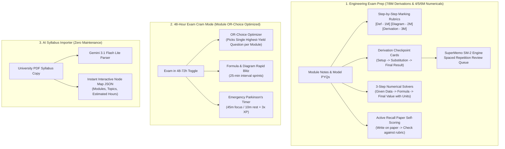
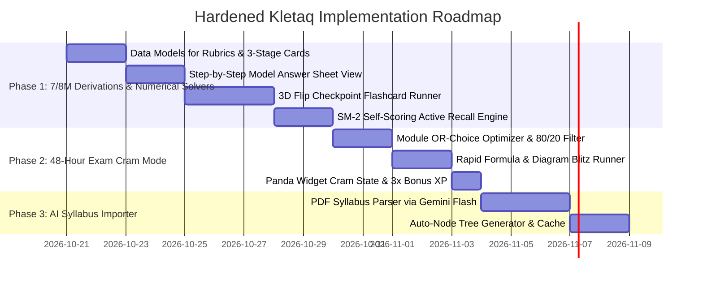

# 🏛️ Kletaq Hardened Master Plan: Engineering AI StudyForge & Exam Mastery Engine

> **Core Philosophy**: Laser-focus on what actually drives academic success for university engineering students: **cracking 7/8-mark derivations, diagrams, and 4/5/6-mark numericals** (modeled directly on real university question papers like VTU 1BPHYS102 Jan 2025), **instant AI syllabus generation**, and **deep-focus habit loops**. We completely reject social stopwatch clutter, complex presence backends, and passive PDF dumps in favor of a clean, high-intensity learning operating system.

---

## 📋 1. Anatomy of an Engineering Exam Paper (The Benchmark)

Based on actual university model papers (e.g. **VTU 1BPHYS102 - Quantum Physics & Applications, Jan 2025**), engineering semester exams are never trivia or simple MCQs. Every 20-mark module strictly follows this triad:

| Question Sub-Part | Real Paper Example (1BPHYS102) | Mark Allocation | How Generic Apps (Anki/Quizlet) Fail | How Kletaq Solves It |
| :--- | :--- | :---: | :--- | :--- |
| **(a) Core Mathematical Derivation** | **Q.4(b)**: Derive expression for Hall voltage with neat diagram & applications. **Q.1(a)**: Time-independent Schrödinger in infinite well. | **7 or 8 Marks** | Tries to give a 1-sentence flashcard answer; student loses 7 marks for missing steps. | **3-Stage Derivation Checkpoints**: Chunks proofs into Setup $\rightarrow$ Substitution $\rightarrow$ Terminal Formula & Units. |
| **(b) Working, Diagram & Comparison** | **Q.6(b)**: Distinguish Type I & Type II superconductors using M-H curves. **Q.5(b)**: Josephson Junction & DC/AC effect. | **7 or 8 Marks** | Generates plain walls of text with no visual guidance or evaluator tips. | **Evaluator Marking Rubric**: Definition [1M] + Labeled Diagram [2M] + Working [3M] + Applications [1M]. |
| **(c) Applied Numerical Problem** | **Q.7(c)**: Core index 1.48, cladding 1.46. Calculate NA & acceptance angle. **Q.4(c)**: Hall coefficient calculation. | **4, 5, or 6 Marks** | Gives just the final number; evaluator gives zero marks if intermediate steps/units are omitted. | **3-Step Numerical Solver**: Given Data & SI units [1M] + Formula [2M] + Calculation & Units with trap warnings [2M]. |

---

## 🚫 2. Traps Avoided & Our Hardened Design Principles

| Potential Trap / Flaw | Why It Fails for Engineering Students | Kletaq's Hardened Solution |
| :--- | :--- | :--- |
| **Full-Textbook RAG Bloat (StudyFetch style)** | Ingesting 200-page textbooks into heavy vector DBs causes high latency, token exhaustion, and forces $15–$25/month user subscriptions. | **Bite-Sized Module Scoping**: Scopes AI analysis strictly to **1 module or 5–8 note pages at a time**. Fits 100% inside Gemini Flash Lite's fast context window within standard free-tier allowances. |
| **Raw Math OCR Hallucinations** | On-device ML Kit OCR frequently garbles handwritten math symbols ($\theta, \int, \frac{\partial}{\partial x}$) into gibberish. | **Hybrid Visual Snippet + Clean Rubrics**: Links cards directly to visual page crops of formulas/diagrams in uploaded notes while Gemini formats clean Unicode/LaTeX step-by-step marking rubrics. |
| **OS-Level App Blocking Risks** | Using Android `AccessibilityService` to forcefully close other apps risks Google Play Store rejection and account bans. | **Parkinson's Law Stakes & OLED Ambient Mode**: Uses positive gamified stakes (2× bonus XP for on-time completion), pure-black battery saver mode, and streak shield loss aversion. |
| **Social Timer Distractions** | Live peer stopwatches create server maintenance overhead, privacy concerns, and battery drain. | **Pure Focus & Competitive Leagues**: Async 10-tier weekly leagues (Bronze → Diamond) and Parkinson's timer stakes keep students focused on studying, not watching other people's timers. |

---

## 🎯 3. The 3 Core Pillars of Kletaq



---

## 🛠️ 4. Concrete Feature Specifications

### Pillar 1: Subjective Exam Prep (Tailored to Model Paper Structure)

1. **3-Stage Derivation Checkpoints (For 7 & 8 Mark Questions)**:
   - Breaks heavy derivations (e.g., Schrödinger 1D Box, Hall Voltage, Numerical Aperture, Einstein's A & B Coefficients) into **3 atomic flashcards**:
     - *Card 1 (The Setup)*: Initial assumptions, governing equation, and labeled diagram.
     - *Card 2 (The Intermediate Pivot)*: Key mathematical substitution, integral bounds, or boundary conditions.
     - *Card 3 (The Final Result & Units)*: Terminal formula, physical significance, and applications.
   - Reviewed with 3D Flip Cards and scheduled via [`SpacedRepetitionEngine.kt`](file:///c:/Users/Akash%20Katageri/Documents/New%20folder/Kletaq/app/src/main/java/com/kletaq/app/core/utils/SpacedRepetitionEngine.kt).

2. **Step-by-Step Evaluator Marking Rubric (For Working & Comparisons)**:
   - Formatted to match what university evaluators grade:
     - `🔹 [Definition / Statement - 1 Mark]`
     - `🔹 [Neat Labeled Diagram / Circuit - 2 Marks]` (with reference to `[Page X]` in uploaded notes)
     - `🔹 [Core Mathematical Derivation / Working - 3–4 Marks]`
     - `🔹 [Applications / Comparison Table - 1–2 Marks]`
     - `💡 [Evaluator Tip: What students usually forget that costs marks]`

3. **3-Step Numerical Problem Solvers (For 4, 5, and 6 Mark Questions)**:
   - Formats numerical prep (de Broglie wavelength, critical field, Hall coefficient, NA & acceptance angle, qubit expectation values):
     - `Step 1: Given Data with SI Unit Conversions [1 Mark]`
     - `Step 2: Core Formula Statement [2 Marks]`
     - `Step 3: Step-by-Step Calculation & Final Value with Correct Units [2 Marks]`
     - `⚠️ [Trap Warning: e.g. "Set calculator to DEG instead of RAD!"]`

4. **Active Recall Paper Self-Grading ("Paper $\rightarrow$ Rubric")**:
   - The student writes the derivation or solves the numerical on physical paper under a Parkinson's timer.
   - Tapping "Reveal Rubric" exposes an interactive checklist matching the exact exam marks.
   - The self-score (e.g. 7/8) updates their memory retention score in the SM-2 engine.

---

### Pillar 2: 48-Hour Exam Cram Mode (Module `OR`-Choice Optimized)

Recognizes that university exam papers offer an **`OR` choice in every module** (5 modules × 20 marks = 100 marks). Students cramming 48 hours before an exam do not need to memorize every question.

* **1-Tap Exam Toggle**:
  - Activated from Home Dashboard or Journey header: *"🚨 Exam in 48 Hours"*.
* **Behavioral Shifts**:
  1. **Module `OR`-Choice Optimizer**: Analyzes past exam frequency and picks the **single highest-probability question path per module** (e.g. Module 1: Master Q1 Schrödinger instead of struggling with both Q1 and Q2).
  2. **80/20 High-Yield Filter**: Dims low-frequency theory; elevates only topics with `⭐ 8M Guaranteed Derivation` or `⭐ 5M Numerical`.
  3. **Formula & Diagram Blitz**: Rapid-fire flashcard carousel cycling through only essential formulas, circuit schematics, and definitions.
  4. **High-Stakes Timer**: 45m focus / 10m rest cycles with **3× Bonus XP** (+60 XP per completed sprint).
  5. **Panda Companion Stance**: Home-screen Panda Glance widget locks into `panda_revision` (*"Exam in 2 days! 5 core derivations locked in 🔥"*).

---

### Pillar 3: AI Syllabus Importer (Zero Curriculum Maintenance)

Eliminates the maintenance overhead of manually typing syllabuses for multiple engineering schemes and branches.

* **How It Works**:
  - The student (or admin) uploads an official university syllabus PDF (e.g., *VTU 2022 Scheme 1BPHYS102*).
  - Gemini Flash Lite processes the document and generates a complete, validated `Subject` JSON tree:
    ```json
    {
      "id": "1BPHYS102",
      "code": "1BPHYS102",
      "name": "Quantum Physics and Applications",
      "units": [
        {
          "unitIndex": 1,
          "title": "Quantum Mechanics Principles",
          "lessons": [
            { "id": "1BPHYS102_M1_T1", "title": "Schrödinger Equation in 1D Box", "estimatedMinutes": 35 },
            { "id": "1BPHYS102_M1_T2", "title": "Heisenberg Uncertainty Principle", "estimatedMinutes": 25 }
          ]
        }
      ]
    }
    ```
  - Instantly renders a new, playable visual node journey without writing a single line of code.

---

## 📅 5. Phased Implementation Roadmap



---

## 🔒 6. Permanent Invariants & Quality Standards

1. **Strict Benchmark Build Variant**:
   - Every feature must build and install via `./gradlew installBenchmark` to ensure 120Hz smooth scrolling on physical Android devices.
2. **Quota & Cost Safety**:
   - Zero background socket/listener spam.
   - LLM generation strictly scoped to single modules/topics to prevent token runaway.
3. **Panda Glance Widget Synchronization**:
   - Co-located SharedPreferences and Glance DataStore state updates must remain atomic.
   - New `panda_revision` stance triggered during Cram Mode and when Spaced Repetition cards are due.
4. **App Release & Website Distribution**:
   - Every completed milestone pushed to `origin master` (triggering GitHub Releases APK workflow).
   - Website APK synced via `powershell -ExecutionPolicy Bypass -File .\update-website-apk.ps1 -SkipBuild`.
